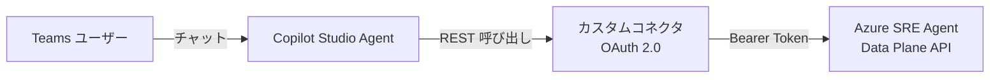

# Copilot Studio × SRE Agent 接続 PoC

## 概要

このシナリオは、**Copilot Studio のカスタムコネクタを通じて Azure SRE Agent の REST API に接続し、Teams から操作できるエージェントを構築する**単発検証（PoC）です。

IaC は含まず、手動構成のみで完結します。将来的に再利用が確定した場合は `infra/scenarios/` へ昇格します。

**シナリオ分類**: `adhoc`（単発・再利用非予定）  
**昇格条件**: 2 回以上再利用された場合、または再利用見込みが明確な場合  
**ドキュメント言語**: 日本語（リソース型名・CLI コマンドは英語）

---

## アーキテクチャ



---

## 前提条件

| 項目 | 内容 |
|---|---|
| Azure SRE Agent | 作成済みで `agentEndpoint` が確認できること |
| Power Platform 環境 | プレミアムライセンスがあること |
| Azure AD テナント | アプリ登録権限、管理者の同意付与権限があること |

---

## 構成要素

| 構成要素 | 役割 |
|---|---|
| **Azure AD アプリ登録** | カスタムコネクタ用 OAuth 2.0 クライアント |
| **カスタムコネクタ** | SRE Agent Data Plane API のラッパー |
| **Copilot Studio エージェント** | Teams 向けフロントエンド |
| **Microsoft Teams** | ユーザーインターフェース |

---

## セットアップ手順

詳細な手順は以下を参照してください。

- [docs/copilot-studio-setup.ja.md](docs/copilot-studio-setup.ja.md) — Azure AD 登録、カスタムコネクタ作成、Copilot Studio エージェント構成、Teams 公開

---

## セキュリティ上の注意

- カスタムコネクタは **OAuth 2.0 Authorization Code Flow** を使用するため、サインインユーザーのトークンでのみ呼び出し可能
- SRE Agent 側で **RBAC ロール** (`SRE Agent User`) を持つユーザーのみに制限すること
- カスタムコネクタの共有設定を特定ユーザー/グループのみに絞ること

```bash
az role assignment create \
  --assignee {userOrGroupId} \
  --role "SRE Agent User" \
  --scope "/subscriptions/{sub}/resourceGroups/{rg}/providers/Microsoft.App/agents/{name}"
```

---

## 関連ドキュメント

- [docs/copilot-studio-setup.ja.md](docs/copilot-studio-setup.ja.md) — 詳細セットアップ手順

---

## リポジトリ方針との整合性

| 項目 | 状態 |
|---|---|
| adhoc 区分 | ✅ |
| README + アーキテクチャ図 | ✅ |
| 日本語ドキュメント | ✅ |
| Bicep / IaC | ❌（手動構成のため対象外） |
| AVM 適用状況 | ❌（IaC なしのため対象外） |

---

## 関連ポリシー

- [シナリオ受付と運用標準](../../docs/operations/scenario-intake-and-standards.md)
- [リポジトリ IaC 方針](../../README.md)
