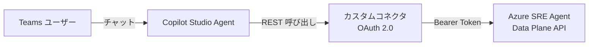

# Copilot Studio から Azure SRE Agent に接続する手順書

## 概要

Copilot Studio のカスタムコネクタを使って Azure SRE Agent の REST API に接続し、Teams から操作できるエージェントを構築する手順です。

---

## アーキテクチャ



---

## 事前準備

- Azure SRE Agent リソースが作成済みであること
- Power Platform の環境があること（プレミアムライセンス必要）
- Azure Portal への管理者アクセス権

### SRE Agent エンドポイントの確認

```bash
az rest -m GET \
  --url "https://management.azure.com/subscriptions/{subscriptionId}/resourceGroups/{resourceGroup}/providers/Microsoft.App/agents/{agentName}?api-version=2025-05-01-preview" \
  --query properties.agentEndpoint -o tsv
```

---

## Step 1: Azure AD アプリ登録

### 1-1. アプリを新規登録

1. [Azure Portal](https://portal.azure.com) → **Azure Active Directory** → **アプリの登録** → **新規登録**
2. 設定:
   - 名前: `copilot-studio-sre-agent`（任意）
   - サポートされるアカウント: **シングルテナント**
3. **登録** をクリック

### 1-2. クライアントシークレットを作成

1. 左メニュー → **証明書とシークレット** → **新しいクライアントシークレット**
2. 説明と有効期限を設定し **追加**
3. 生成された **値** をコピーして保存（後で参照不可）

### 1-3. API のアクセス許可を追加

1. 左メニュー → **API のアクセス許可** → **アクセス許可の追加**
2. **自分の組織が使用する API** タブ → `Azure SRE` を検索
3. **委任されたアクセス許可** → `Threads.ReadWrite.All` を選択 → **アクセス許可の追加**
4. **「\<テナント名\> に管理者の同意を与えます」** をクリック ✅

### 1-4. リダイレクト URI は後で追加

カスタムコネクタ作成後に追加します（Step 2-4 参照）。

---

## Step 2: カスタムコネクタの作成

### 2-1. Power Apps でカスタムコネクタを作成

1. [make.powerapps.com](https://make.powerapps.com) → **データ** → **カスタムコネクタ** → **新規作成** → **OpenAPI ファイルのインポート**
2. 以下の Swagger 定義をインポート

### 2-2. Swagger 定義

以下の YAML を `.json` または `.yaml` として保存してからインポートしてください。  
`host:` の値は実際の SRE Agent エンドポイントに変更してください。

```yaml
swagger: '2.0'
info:
  title: Azure SRE Agent
  description: Azure SRE Agent data plane API for Copilot Studio
  version: '1.0'
host: {agentName}.{hash}.{region}.azuresre.ai   # 実際のエンドポイントに変更
basePath: /api/
schemes:
  - https
consumes:
  - application/json
produces:
  - application/json
paths:
  /v1/threads:
    post:
      summary: Create thread
      description: Create a new conversation thread with an initial message
      operationId: CreateThread
      parameters:
        - in: body
          name: body
          required: true
          schema:
            type: object
            required:
              - StartMessage
            properties:
              StartMessage:
                type: object
                required:
                  - Text
                properties:
                  Text:
                    type: string
                    description: 最初のメッセージ内容
      responses:
        '200':
          description: OK
          schema:
            type: object
            properties:
              id:
                type: string
                description: threadId
              title:
                type: string
              lastMessage:
                type: object
                properties:
                  text:
                    type: string
                  author:
                    type: object
                    properties:
                      role:
                        type: string
                      displayName:
                        type: string
    get:
      summary: List threads
      description: List all conversation threads
      operationId: ListThreads
      responses:
        '200':
          description: OK
          schema:
            type: object
  /v1/threads/{threadId}:
    get:
      summary: Get thread
      description: Get a thread including the latest message from SRE Agent
      operationId: GetThread
      parameters:
        - in: path
          name: threadId
          required: true
          type: string
      responses:
        '200':
          description: OK
          schema:
            type: object
            properties:
              id:
                type: string
              lastMessage:
                type: object
                properties:
                  text:
                    type: string
                  author:
                    type: object
                    properties:
                      role:
                        type: string
                      displayName:
                        type: string
                  azCliExecution:
                    type: object
                    properties:
                      id:
                        type: string
                      command:
                        type: string
                      status:
                        type: string
  /v1/azCliExecution/{threadId}/{executionId}/action:
    post:
      summary: Approve execution
      description: Approve or reject a pending CLI execution
      operationId: ApproveExecution
      parameters:
        - in: path
          name: threadId
          required: true
          type: string
        - in: path
          name: executionId
          required: true
          type: string
        - in: body
          name: body
          required: true
          schema:
            type: object
            properties:
              action:
                type: string
                description: "run = 承認, reject = 却下"
                enum: [run, reject]
                default: run
                x-ms-visibility: internal
              user:
                type: string
                default: agent
                x-ms-visibility: internal
              ApproveForThread:
                type: boolean
                default: true
                x-ms-visibility: internal
      responses:
        '200':
          description: OK
security:
  - oauth2-auth:
      - https://azuresre.dev/.default
tags: []
securityDefinitions:
  oauth2-auth:
    type: oauth2
    flow: accessCode
    authorizationUrl: https://login.microsoftonline.com/common/oauth2/authorize
    tokenUrl: https://login.windows.net/common/oauth2/authorize
    scopes:
      https://azuresre.dev/.default: https://azuresre.dev/.default
```

### 2-3. セキュリティタブの設定

| 項目 | 値 |
|---|---|
| 認証タイプ | `OAuth 2.0` |
| ID プロバイダー | `Azure Active Directory` |
| クライアント ID | Step 1 で作成したアプリの **アプリケーション (クライアント) ID** |
| クライアント シークレット | Step 1-2 で作成した **シークレットの値** |
| リソース URL | `https://azuresre.dev` |
| スコープ | （空欄） |

### 2-4. リダイレクト URI を Azure AD に登録

1. セキュリティタブに表示された **「リダイレクト URL」** をコピー
   - 例: `https://global.consent.azure-apim.net/redirect/azuresreconnector1-xxx`
2. Azure Portal → アプリ登録 → **認証** → **プラットフォームを追加** → **Web**
3. コピーした URL を貼り付けて **保存**

### 2-5. コネクタを保存してテスト

1. **「コネクタの作成」** をクリック
2. **テスト** タブ → **新しい接続** → サインイン
3. `ListThreads` を実行して 200 OK が返ることを確認

---

## Step 3: Copilot Studio でエージェントを作成

### 3-1. 新規エージェントを作成

1. [copilotstudio.microsoft.com](https://copilotstudio.microsoft.com)
2. **作成** → **新しいエージェント**
3. 名前: `SRE Agent アシスタント`（任意）

### 3-2. エージェントの Instructions（指示文）

```
## 役割
あなたは Azure SRE Agent のフロントエンドアシスタントです。
ユーザーから Azure インフラに関する質問を受け取り、SRE Agent API を通じて回答を取得して返します。

## 会話の流れ
1. ユーザーから質問を受け取る
2. CreateThread アクションを呼び出す
   - StartMessage.Text にユーザーの質問をそのまま渡す
   - レスポンスの id を threadId として保存する
3. 5秒待機後、GetThread アクションを呼び出す
   - threadId を渡す
4. GetThread のレスポンスを確認する:
   - lastMessage.azCliExecution.status が "Pending" の場合 → 承認フローへ
   - lastMessage.author.role が "SREAgent" の場合 → 回答をユーザーに返す
   - それ以外の場合 → さらに5秒待機して再度 GetThread を呼ぶ（最大3回）

## 承認が必要な場合の処理
GetThread で lastMessage.azCliExecution.status が "Pending" の場合:
1. 実行されるコマンド（lastMessage.azCliExecution.command）をユーザーに表示する
2. 「このアクションを承認しますか？（はい/いいえ）」と確認する
3. 「はい」の場合:
   - ApproveExecution を呼び出す
   - threadId: 現在の threadId
   - executionId: lastMessage.azCliExecution.id
4. 「いいえ」の場合:
   - action を "reject" にして ApproveExecution を呼び出す
5. 承認後、5秒待って GetThread で最終結果を取得してユーザーに返す

## 返答のルール
- SRE Agent の回答（lastMessage.text）をユーザーに返す
- 英語の回答は日本語に翻訳する
- 技術用語・コマンド・リソース名はそのまま使う
- 回答が取得できない場合は「SRE Agent が応答中です。しばらくしてからもう一度お試しください。」と伝える

## 対応する質問の例
- Azure リソースの状態確認
- コスト・課金の確認
- インシデント対応
- デプロイ・設定変更の相談
```

### 3-3. アクションを追加

1. トピック → **システムトピック「会話の開始」** または新規トピックを作成
2. **アクションを追加** → **コネクタアクション**
3. `Azure SRE Agent` コネクタを選択
4. 以下のアクションを追加:
   - `CreateThread`
   - `GetThread`
   - `ApproveExecution`

### 3-4. Teams に公開

1. Copilot Studio → **チャンネル** → **Microsoft Teams** → **有効化**
2. **公開** → **公開**
3. Teams アプリとして追加して動作確認

---

## API リファレンス

### スレッド作成

```
POST /api/v1/threads
Authorization: Bearer {token}

{
  "StartMessage": {
    "Text": "メッセージ内容"
  }
}

→ レスポンス: { "id": "{threadId}", ... }
```

### スレッド取得（エージェント返答確認）

```
GET /api/v1/threads/{threadId}
Authorization: Bearer {token}

→ レスポンス:
{
  "lastMessage": {
    "author": { "role": "SREAgent" },
    "text": "エージェントの回答",
    "azCliExecution": {         // 承認待ちの場合のみ
      "id": "{executionId}",
      "command": "az ...",
      "status": "Pending"
    }
  }
}
```

### 承認実行

```
POST /api/v1/azCliExecution/{threadId}/{executionId}/action
Authorization: Bearer {token}

{
  "action": "run",          // "run" = 承認, "reject" = 却下
  "user": "agent",          // 任意の文字列
  "ApproveForThread": true
}
```

### 認証トークン取得（テスト用）

```bash
TOKEN=$(az account get-access-token --resource https://azuresre.dev --query accessToken -o tsv)
```

---

## トラブルシューティング

| エラー | 原因 | 対処 |
|---|---|---|
| `AADSTS50011: redirect URI mismatch` | リダイレクト URI 未登録 | Azure AD アプリの「認証」にリダイレクト URI を追加 |
| サインイン後に接続が表示されない | クライアントシークレットの期限切れ | 新しいシークレットを作成してコネクタを更新 |
| `400 StartMessage field is required` | リクエストボディの形式が違う | `{"StartMessage": {"Text": "..."}}` のネスト構造を使う |
| `400 request field is required` | ボディが正しくネストされていない | `StartMessage` を直接トップレベルに置かない |
| `405 Method Not Allowed` | パスパラメータが空 | `threadId` / `executionId` 変数をセットし直す |
| カスタムコネクタのアクションが古い | キャッシュ | 接続を削除して再作成、または別名でコネクタを作り直す |

---

## セキュリティ考慮事項

- カスタムコネクタは **OAuth 2.0 Authorization Code Flow** を使用するため、サインインしたユーザーのトークンでのみ呼び出せる
- SRE Agent 側で **RBAC ロール** (`SRE Agent User`) を持つユーザーのみに絞ること:

```bash
az role assignment create \
  --assignee {userOrGroupId} \
  --role "SRE Agent User" \
  --scope "/subscriptions/{sub}/resourceGroups/{rg}/providers/Microsoft.App/agents/{name}"
```

- カスタムコネクタの **共有設定** を特定のユーザー/グループのみに制限する
