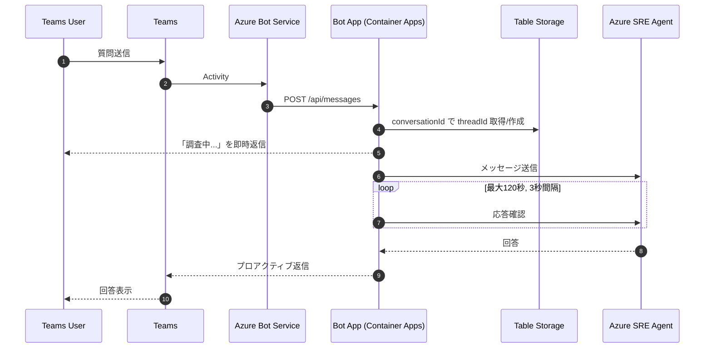

# SRE Agent + Teams Bot アーキテクチャ解説

この文書は、infra/custom/sre-agent-teams-poc が何を実現しているかを、初見者に説明するための資料です。

短時間で説明する場合は docs/onepage-architecture.ja.md を先に参照してください。

## 1. このPOCの目的

Microsoft Teams から Azure 運用に関する質問を送ると、Azure SRE Agent が調査し、Bot が Teams へ回答を返す仕組みを提供します。

狙いは次の 3 点です。

1. Teams を窓口にした運用問い合わせの体験を検証する
2. シークレットレス認証 (Managed Identity) で安全に連携する
3. IaC とスクリプトで再現可能な検証環境を短時間で作る

## 2. 全体構成

主要コンポーネントと役割は次のとおりです。

1. Teams
ユーザーが質問を送る UI。

2. Azure Bot Service
Teams チャネルとの接続点。受信したメッセージを Bot アプリへ中継。

3. Azure Container Apps
Node.js の Bot アプリ実行基盤。/api/messages を公開。

4. Azure SRE Agent
問い合わせ内容を調査して回答を生成するエージェント。

5. Azure Table Storage
Teams conversationId と SRE Agent threadId の対応表を保存。

6. User Assigned Managed Identity
Bot アプリ、Storage、ACR、SRE Agent 連携の認証に使用。

7. Azure Container Registry
Bot コンテナーイメージを格納。

8. Application Insights + Log Analytics
ログ収集と監視。

## 3. 処理シーケンス

設計上のポイント:

1. 即時返信で Teams 側タイムアウトを回避
2. 長い調査は非同期で待機
3. conversation 単位のスレッド継続で文脈を維持

## 4. フォルダごとの実装責務

1. bicep/
Azure リソース一式を宣言。ロール割り当て、環境変数注入、Bot Service と Teams Channel の有効化を実施。

2. bot-app/
Teams Bot 本体。HTTP 受信、Bot Framework 処理、SRE Agent API 呼び出し、プロアクティブ返信を実装。

3. teams-manifest/
Teams アプリ定義。botId、scopes、permissions、validDomains を保持。

4. *.ps1
デプロイ、リセット、後片付けを自動化。

5. RUNBOOK.ja.md
初回利用者向けの実行手順と運用手順。

## 5. 代替サービスの選択肢

### 5.1 Bot実行基盤

1. 現在: Container Apps
利点: スケール容易、コンテナー実行に素直、構成がシンプル。

2. 代替: App Service
利点: 運用経験が豊富なチームで扱いやすい。
注意: コンテナー運用やスケール設定の思想が少し異なる。

3. 代替: Azure Functions
利点: 低トラフィック時のコスト最適化。
注意: 長時間処理やプロアクティブ返信設計の調整が必要。

### 5.2 会話マッピング保存

1. 現在: Table Storage
利点: 安価、Key-Value用途に十分。

2. 代替: Cosmos DB
利点: 大規模・グローバル分散に強い。
注意: コストと運用複雑度が上がる。

3. 代替: Redis
利点: 高速。
注意: 永続性要件がある場合は別途永続層が必要。

### 5.3 AI基盤

1. 現在: Azure SRE Agent
利点: Azure運用文脈と相性が良い。

2. 代替: Azure OpenAI
利点: 汎用LLMとして柔軟。
注意: 運用知識の取り込みとツール連携を別途設計する必要がある。

### 5.4 認証

1. 現在: User Assigned Managed Identity
利点: シークレット不要、ローテーション不要、漏えいリスク低減。

2. 代替: Service Principal + Secret
利点: 従来方式で導入しやすい。
注意: 秘密情報管理の運用負荷が増える。

## 6. 説明用の要点 (3分版)

1. Teams で質問すると Bot が受け取り、SRE Agent に中継する
2. Bot は最初に「調査中」を返し、結果が出たら追って回答する
3. 会話IDとスレッドIDを Storage に保存して、会話の連続性を保つ
4. 認証は Managed Identity で統一してシークレットレス
5. 構築と破棄は Bicep + PowerShell で再現可能

## 7. どのファイルを見れば理解できるか

1. bicep/main.bicep
インフラ全体像と権限設定

2. bot-app/src/server.js
受信エンドポイントと Bot アダプター

3. bot-app/src/bot.js
メッセージ処理とプロアクティブ返信

4. bot-app/src/sreAgentClient.js
SRE Agent API 呼び出し

5. bot-app/src/threadStore.js
会話マッピング保存

6. teams-manifest/manifest.json
Teams 側のアプリ定義

7. RUNBOOK.ja.md
実行・運用手順
