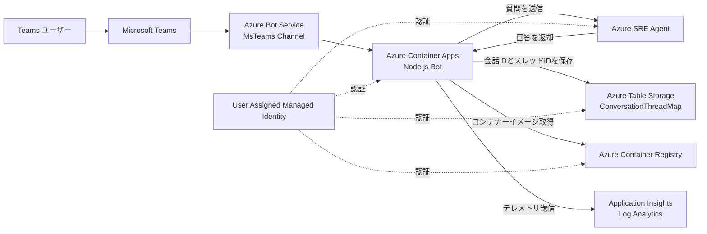
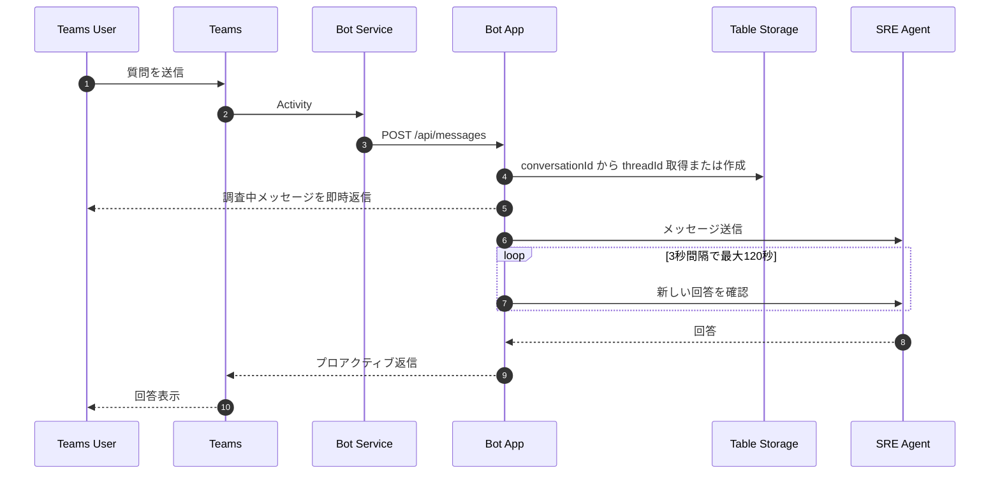
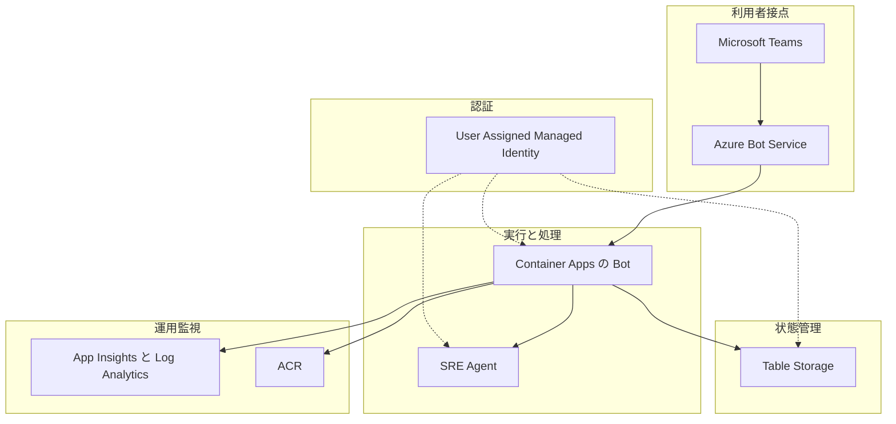

# SRE Agent Teams Bot 図解 1ページ

このページは、初見の人に 3 分で全体像を伝えるための図解資料です。

## 1. 一言でいうと

Teams で質問した内容を Bot が受け取り、Azure SRE Agent に中継し、調査結果を Teams に返す仕組みです。

## 2. 論理アーキテクチャ

## 3. 会話シーケンス

## 4. サービス責務マップ

## 5. 代替サービス早見表

| 領域 | 現在 | 代替候補 | 使い分けの目安 |
|---|---|---|---|
| Bot実行基盤 | Container Apps | App Service, Azure Functions, AKS | 小中規模は Container Apps、大規模制御は AKS |
| 会話マッピング | Table Storage | Cosmos DB, Redis | 大規模分散は Cosmos DB、高速キャッシュは Redis |
| AI基盤 | Azure SRE Agent | Azure OpenAI | 汎用対話中心なら Azure OpenAI |
| 認証 | UAMI | Service Principal + Secret | 原則 UAMI を優先 |
| IaC | Bicep | Terraform | マルチクラウド統一要件なら Terraform |

## 6. 説明トーク 60 秒版

1. Teams の質問が Bot Service 経由で Container Apps の Bot に届きます。
2. Bot は会話の対応表を Table Storage で管理し、まず調査中メッセージを即時返信します。
3. 裏で SRE Agent に問い合わせ、回答が出たらプロアクティブに Teams へ返します。
4. 認証は UAMI で統一し、シークレットを持たない運用にしています。
