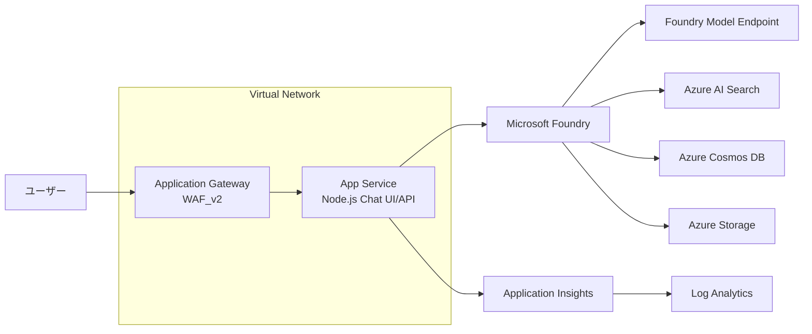

# アーキテクチャ

## 構成図

## 設計意図

- チャットフロントは App Service でホストし、公開入口は Application Gateway に集約
- WAF を Prevention モードで有効化し、Web 攻撃面を縮小
- Foundry と依存データサービスを同リージョンに配置し、遅延と運用複雑性を抑制
- 監視は Log Analytics + App Insights に統合

## セキュリティ方針

- App Service は HTTPS Only、最小 TLS 1.2
- Storage は `allowBlobPublicAccess: false`
- サブネットに NSG を適用し、不要な inbound を制限
- WAF は OWASP 3.2、Prevention モード

## 今後の強化候補

- App Gateway の TLS 終端 + Key Vault 証明書連携
- Foundry / Cosmos / Search / Storage の Private Endpoint 化
- Azure Firewall 経由の強制エグレス
- マルチリージョン DR（RTO/RPO 要件に応じて）
