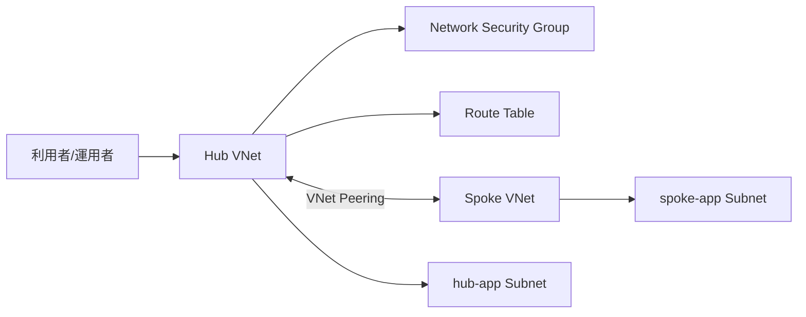

# hub-spoke アーキテクチャ

## 概要
Hub VNet と Spoke VNet をピアリングし、Hub 側でセキュリティ制御と経路制御を集約する構成です。

## 構成図

## 主要ポイント
- Hub 側に NSG と Route Table を配置して制御点を集約。
- Spoke は最小構成でアプリ用途のサブネットのみ配置。
- リージョン既定値は southwestasia。
