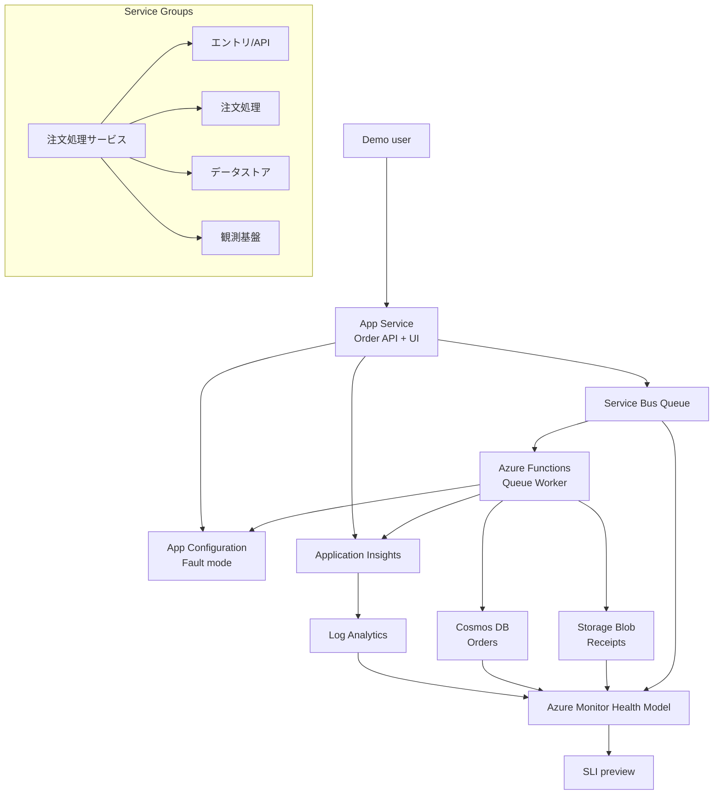

# Service Group / Health Model / SLI デモ

Azure Service Groups、Azure Monitor Health Model、Service Level Indicator (SLI) の違いと関係を、実際の Azure リソースで確認するための標準シナリオです。

このシナリオでは、注文処理サービスを App Service、Azure Functions、Service Bus、Cosmos DB、Storage、App Configuration、Application Insights、Log Analytics、Azure Monitor Workspace で構成します。単一 VM ではなく、複数 Azure サービスを組み合わせた小さなサービスとして作り、Service Group で束ね、Health Model で状態を伝播させ、SLI で availability/latency の目標を観察します。

## まず押さえる違い

| 観点 | Service Group | Resource Group | Subscription | Management Group |
|---|---|---|---|---|
| 主な目的 | サービス/アプリケーション単位で複数リソースを論理的に束ねる | デプロイ、ライフサイクル、RBAC、Policy の基本管理境界 | 課金、クォータ、RBAC、Policy の大きな管理境界 | 複数 subscription を階層化してガバナンスする |
| 階層の意味 | サービス構造や運用責任を表現する | 基本的にリソースの所属先 | 課金・契約・大きな環境境界 | 組織・プラットフォーム境界 |
| リソースの所属 | 既存リソースに relationship を張る。物理的な配置先ではない | リソースは 1 つの RG に所属する | RG は 1 つの subscription に所属する | subscription を配下に置く |
| RBAC | Service Group 自体の管理権限は扱えるが、既存 RG/subscription の RBAC 境界を置き換えない | 実リソース操作の標準的な RBAC scope | subscription 全体の RBAC scope | 複数 subscription への RBAC 継承 scope |
| Cost Management | サービス観点の整理に使えるが、課金境界そのものではない | RG 単位のコスト集計に使いやすい | 課金と予算の主要単位 | 組織横断の分析・方針管理 |
| tags | Service Group に tags を付けられる。メンバーリソースの tags を自動置換するものではない | リソース/RG tags としてコスト・運用分類に使う | subscription tags は分類補助 | 管理階層の分類補助 |
| Azure Policy | preview の relationship と組み合わせた活用余地はあるが、従来の Policy scope を直ちに置き換えるものではない | Policy assignment の標準 scope | Policy assignment の標準 scope | 大規模 Policy assignment の標準 scope |

Service Group は、従来の Resource Group や Subscription をなくすものではありません。既存の Azure 管理境界の上に、サービス/システム観点のまとまりを追加するものとして見ると理解しやすいです。

## Health Model と SLI との関係

| 要素 | 役割 | このデモでの使い方 |
|---|---|---|
| Service Group | サービスを構成する Azure リソースを論理的に束ねる | root `注文処理サービス` と、`エントリ/API`、`注文処理`、`データストア`、`観測基盤` の子 Service Group を作る |
| Health Model | サービス内の entity と依存関係をモデル化し、signal から正常/劣化/異常を評価する | root entity から tier entity、leaf resource entity へ二、三階層で状態を伝播させる |
| SLI | availability や latency など、サービス目標に対する指標を定義する | preview の `Microsoft.Monitor/slis` で availability と latency を分離定義する |

SLI は Service Group の子リソースではなく、Azure Monitor の preview extension resource です。このため、本シナリオでは `sli-preview.bicep` を独立させ、Service Group scope と Azure Monitor Workspace metric source の組み合わせを検証しやすくしています。

## アーキテクチャ



## 作成される主なリソース

- `Microsoft.Management/serviceGroups@2024-02-01-preview`
- `Microsoft.Relationships/serviceGroupMember@2023-09-01-preview`
- `Microsoft.Web/sites` / `Microsoft.Web/serverfarms`
- `Microsoft.ServiceBus/namespaces` / `queues`
- `Microsoft.DocumentDB/databaseAccounts`
- `Microsoft.Storage/storageAccounts`
- `Microsoft.AppConfiguration/configurationStores`
- `Microsoft.OperationalInsights/workspaces`
- `Microsoft.Insights/components`
- `Microsoft.Monitor/accounts`
- `Microsoft.Monitor/accounts/healthmodels` と child resources
- `Microsoft.Monitor/slis@2025-03-01-preview`

## デプロイ

### 動作確認済み範囲を最短で再現する

以下の手順で、Service Group 階層、App Service API、Service Bus、Cosmos DB、Storage、App Configuration、Application Insights、Log Analytics、Azure Monitor Workspace、Function App リソースを作成できます。現在の subscription では Health Model / SLI preview API が利用できないため、まずは両方をスキップして、動作確認済み範囲を再現します。

```powershell
cd infra/scenarios/service-group-sli-demo

./deploy.ps1 `
  -ScenarioCode sgsli01 `
  -Location southeastasia `
  -SubscriptionId <subscription-id> `
  -SkipHealthModel `
  -SkipSli `
  -CleanupOnFailure

./validate-demo.ps1 -ScenarioCode sgsli01
./run-demo-traffic.ps1 -ScenarioCode sgsli01 -Count 10

./set-fault.ps1 -ScenarioCode sgsli01 -Mode api
./set-fault.ps1 -ScenarioCode sgsli01 -Mode none
```

正常時は `/healthz` が `status=ok`、注文 API が HTTP 202、トラフィック生成結果が `queued=True` になります。`api` 障害モードでは `/healthz` が `status=degraded`、注文 API が HTTP 503 になります。`none` に戻すと `status=ok` に復旧します。

デモ終了後は必ず削除します。

```powershell
./cleanup.ps1 -ScenarioCode sgsli01 -Force
az group wait --name rg-service-group-sli-demo-sgsli01 --deleted
```

> [!IMPORTANT]
> Function App のリソースと Managed Identity/RBAC は作成されますが、worker コードの配置は既定では行いません。また、Health Model と SLI は Bicep 定義を含みますが、現在の検証環境では preview Resource Provider の制約によりライブ動作確認の対象外です。

### 通常のデプロイ

```powershell
cd infra/scenarios/service-group-sli-demo
./deploy.ps1 -ScenarioCode sgsli01 -Location southeastasia -CleanupOnFailure
```

`deploy.ps1` は Foundry Chat Baseline で実績のある方式を使用します。Node.js API と Web UI をソース ZIP にまとめ、App Service の `SCM_DO_BUILD_DURING_DEPLOYMENT=true` と `ENABLE_ORYX_BUILD=true` を有効化して、Oryx に依存関係を復元させます。注文 API は App Service のユーザー割り当て Managed Identity で App Configuration、Service Bus、Cosmos DB に接続します。`-CleanupOnFailure` を付けると、途中で失敗した場合に今回の Resource Group と Service Group の削除を要求し、不要なコストが残らないようにします。

Web API は Linux App Service の B1 Basic と Node.js 22 LTS を使用します。検証終了後は `cleanup.ps1` で必ず削除してください。

Function App は Flex Consumption のリソース、ID、Service Bus/Cosmos/Storage の権限まで一発で構成されます。デプロイ用 Storage も user-assigned managed identity で認証し、Storage 共有キーは使用しません。worker コードの One Deploy は Storage/SCM ポリシーによって 403 が発生する環境があるため、既定では行いません。worker コードも検証したい場合だけ、Node.js 22 以降をインストールして次のように明示指定します。

```powershell
./deploy.ps1 -ScenarioCode sgsli01 -Location southeastasia -CleanupOnFailure -DeployFunctionWorker
```

既存 Service Group の配下に root Service Group を作る場合:

```powershell
./deploy.ps1 -ScenarioCode sgsli01 -Location southeastasia -ParentServiceGroupResourceId "/providers/Microsoft.Management/serviceGroups/<parent-name>"
```

Health Model / SLI preview を失敗時に厳格に扱いたい場合:

```powershell
./deploy.ps1 -ScenarioCode sgsli01 -Location southeastasia -CleanupOnFailure -StrictPreview
```

`StrictPreview` を指定しない場合、`Microsoft.Monitor/accounts/healthmodels` や `Microsoft.Monitor/slis` の preview RP が subscription/region 側で未有効のときは警告を出して workload とアプリのデプロイを継続します。

Health Model または SLI preview の capability check を後回しにしたい場合:

```powershell
./deploy.ps1 -ScenarioCode sgsli01 -Location southeastasia -SkipHealthModel
./deploy.ps1 -ScenarioCode sgsli01 -Location southeastasia -SkipSli
```

## 障害注入

```powershell
./set-fault.ps1 -Mode none
./set-fault.ps1 -Mode api
./set-fault.ps1 -Mode queue
./set-fault.ps1 -Mode worker
./set-fault.ps1 -Mode cosmos
./set-fault.ps1 -Mode storage
./set-fault.ps1 -Mode latency
```

`set-fault.ps1` は Web API 経由で障害モードを更新します。Web API の managed identity には App Configuration Data Owner を付与しているため、App Configuration の local auth を無効化したまま操作できます。

> [!WARNING]
> 障害モード変更 API はデモ操作を簡単にするため認証を実装していません。この環境は短時間の検証専用とし、インターネット公開したまま継続運用しないでください。

| Mode | 期待される挙動 | 観察ポイント |
|---|---|---|
| `none` | API 受付、queue 投入、worker 処理、Cosmos/Storage 書き込みが正常 | root/tier/leaf が healthy に近づく |
| `api` | API が 503 を返す | API leaf と API tier の劣化/異常、availability SLI 低下 |
| `queue` | API が queue 投入前に 503 を返す | API path の失敗率上昇 |
| `worker` | Function worker が例外を投げる | Processing tier と queue backlog の悪化 |
| `cosmos` | worker が Cosmos 書き込み前に失敗 | Data tier の Cosmos 側が悪化 |
| `storage` | worker が Storage 書き込み前に失敗 | Data tier の Storage 側が悪化 |
| `latency` | API/worker が遅延する | latency SLI と API latency signal の悪化 |

トラフィック生成:

```powershell
./run-demo-traffic.ps1 -Count 30
```

検証:

```powershell
./validate-demo.ps1 -ScenarioCode sgsli01
```

## Bicep 検証

```powershell
az bicep build --file infra/scenarios/service-group-sli-demo/bicep/main.bicep --stdout | Out-Null
az bicep build --file infra/scenarios/service-group-sli-demo/bicep/service-groups.bicep --stdout | Out-Null
az bicep build --file infra/scenarios/service-group-sli-demo/bicep/service-group-members.bicep --stdout | Out-Null
az bicep build --file infra/scenarios/service-group-sli-demo/bicep/health-model.bicep --stdout | Out-Null
az bicep build --file infra/scenarios/service-group-sli-demo/bicep/sli-preview.bicep --stdout | Out-Null
az bicep build --file infra/scenarios/service-group-sli-demo/bicep/sli-rbac.bicep --stdout | Out-Null
az bicep build --file infra/scenarios/service-group-sli-demo/bicep/sli-amw-rbac.bicep --stdout | Out-Null
az bicep build --file infra/scenarios/service-group-sli-demo/bicep/sli-dcr-rbac.bicep --stdout | Out-Null
```

## アプリ検証

```powershell
cd apps/service-group-sli-demo
npm install
npm test

cd ../service-group-sli-demo-function
npm install
npm test
```

## preview と権限の注意

- Service Group は tenant scope のため、通常の Resource Group Contributor だけでは作成できない可能性があります。
- Service Group の親は必須です。親を指定しない場合、デプロイスクリプトは root Service Group `/providers/Microsoft.Management/serviceGroups/<tenantId>` を親にします。
- 現在のデプロイスクリプトは、tenant-scope deployment 権限がない環境でも動かしやすいよう、Service Group 作成だけ REST API で実行します。Bicep ファイルは構成確認と tenant deployment 権限がある環境向けの参照として残しています。
- `Microsoft.Relationships/serviceGroupMember` は extension resource です。この README の構成では各 workload resource を scope にし、`targetId` に Service Group ID を指定します。preview 仕様で relationship の向きが変わる場合は `service-group-members.bicep` だけを調整します。
- Health Model は `Microsoft.Monitor/accounts/healthmodels` 系を使います。`Microsoft.CloudHealth` 系は今回の第一候補にはしていません。
- Health Model の system-assigned managed identity には、同一 Resource Group の Log Analytics と Azure resource metrics を読み取るため `Monitoring Reader` を割り当てます。この RBAC 作成には `Microsoft.Authorization/roleAssignments/write` 権限が必要です。
- Health Model の Service Group discovery は preview API の環境差を受けやすいため、既定では明示的な entity/relationship モデルを作成します。必要な場合は `health-model.bicep` の `enableServiceGroupDiscovery` を `true` にして discovery scope を検証します。
- 2026-07 時点の検証では、公式 Bicep schema に `Microsoft.Monitor/accounts/healthmodels@2025-05-03-preview` が存在していても、subscription の resource provider metadata に `accounts/healthmodels` が露出せず、実 PUT が `Not Found` または空の `BadRequest` になる環境があります。この場合、`deploy.ps1` は既定で workload/app を継続デプロイし、`-StrictPreview` 指定時のみ失敗扱いにします。
- `Microsoft.Monitor/slis` は preview であり、Azure Monitor Workspace の metric source 要件が実デプロイ時に追加で判明する可能性があります。そのため SLI は `sli-preview.bicep` に分離しています。
- SLI には専用の user-assigned managed identity を使用します。`sli-rbac.bicep` は source/destination Azure Monitor Workspace と、その managed Resource Group にある既定 Data Collection Rule に `Monitoring Reader` / `Monitoring Metrics Publisher` を割り当てます。この subscription-scope RBAC デプロイには `Microsoft.Authorization/roleAssignments/write` 権限が必要です。

## AVM 適用状況

このシナリオは direct resource 定義を採用しています。

| 対象 | 状況 | 理由 |
|---|---|---|
| preview resources | direct | Service Group、Service Group membership、Health Model、SLI は preview 型であり、AVM 化より schema 追従と検証容易性を優先 |
| App Service / Functions / Storage / Service Bus / Cosmos DB | direct | このリポジトリでは過去に AVM remote module の `bicep build` が安定しないケースがあり、まず動作検証可能な direct 定義を優先 |
| 将来の移行条件 | 未実施 | preview 型の安定化、AVM module の利用可否確認、既存シナリオとの共通化判断後に見直す |
| 次回見直し | 2026-Q3 | 定期 AVM バージョンレビュー時、および Health Model/SLI の GA または対応 AVM 公開時に再判定 |

## クリーンアップ

```powershell
./cleanup.ps1 -ScenarioCode sgsli01 -Force
```

`cleanup.ps1` は Resource Group、Azure Monitor の managed Resource Group、tenant-scope Service Group を削除し、すべての削除完了まで待機します。削除操作のため、必ず対象を確認してから実行してください。
